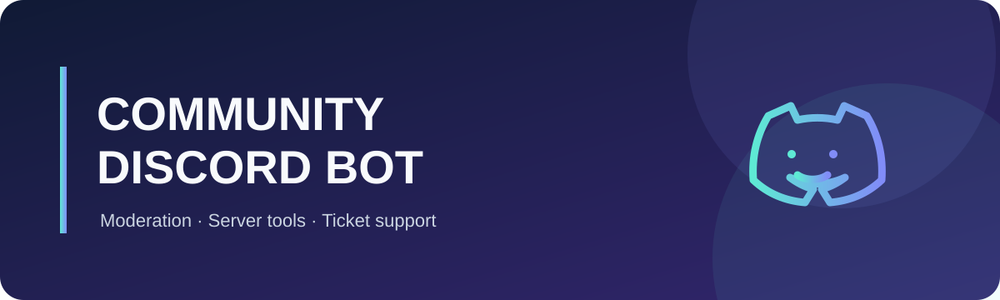

<div align="center">



# Community Discord Bot

**Discord.js v14 ile hazırlanmış, yapılandırılabilir moderasyon ve topluluk botu.**

[](https://nodejs.org/)
[](https://discord.js.org/)
[](LICENSE)

</div>

## Özellikler

- Ayrı slash komutlarıyla moderasyon: ban, kick, timeout, uyarı, mesaj temizleme, rol ve kanal yönetimi.
- Sunucu kilitleme ve geri açma; denetim kaydı ve anti-nuke koruması.
- Hoş geldin/veda mesajları, otomatik rol, doğrulama ve rol paneli.
- Ticket destek paneli, tetikleyici yanıtlar, kullanıcı kara listesi ve XP sıralaması.
- Yapılandırılabilir `/ip` ve `!ip` kartı ile Minecraft sunucu durumu.
- Sunucuya özel kimlikler ve adresler `.env` dosyasında tutulur; örnek dosyada gerçek sır veya ID bulunmaz.

## Kurulum

Gereksinimler: Node.js 20 veya üzeri ve bir Discord uygulaması/botu.

Windows PowerShell'de proje klasöründe:

```powershell
npm install
Copy-Item .env.example .env
notepad .env
npm run deploy
npm start
```

`.env` dosyasına en azından Discord bot token'ını ve uygulama ID'sini gir. Komutları önce tek bir test sunucusuna eklemek için `GUILD_ID` alanına o sunucunun ID'sini yaz. Boş bırakırsan komutlar global kaydedilir; Discord'da görünmeleri daha uzun sürebilir.

Botu sürekli çalıştırmak için `npm start` işlemini açık tut veya uygulamayı Node.js destekli bir sunucuya dağıt. Botu yeniden başlatmadan önce `.env` değerlerini kontrol et.

## GitHub'a yükleme

Önce GitHub'da boş bir repository oluştur. Sonra proje klasöründe `<kullanici>` ve `<repo>` yerlerini kendi GitHub bilgilerinle değiştir:

```powershell
git init -b main
git add .
git status --short
git commit -m "Prepare public release"
git remote add origin https://github.com/<kullanici>/<repo>.git
git push -u origin main
```

İlk `git push` öncesinde `git status` çıktısında `.env`, `data/` veya gizli bir dosya olmadığını kontrol et. `.gitignore` bunları dışarıda tutar.

## Discord ayarları

Developer Portal → **Bot → Privileged Gateway Intents** bölümünden gereken intent'leri aç:

- **Server Members Intent**: üye katılımı, otomatik roller ve topluluk etiketi eşlemesi için.
- **Message Content Intent**: `!ip`, tetikleyiciler ve ticket mesajları için.

Bot davet bağlantısında `bot` ve `applications.commands` OAuth kapsamlarını seç. Bot rolüne yalnızca kullanacağın özelliklerin izinlerini ver; Administrator izni gerekmez. Moderasyon, rol/kanal yönetimi, hoş geldin ve ticket özellikleri ilgili Discord izinlerini ve uygun rol sırasını gerektirir.

## Yapılandırma

`.env.example` içindeki alanları kendi botuna ve sunucuna göre düzenle:

| Değişken | Açıklama |
| --- | --- |
| `TOKEN` | Discord bot token'ı. Gizli tut; GitHub'a yükleme. |
| `CLIENT_ID` | Discord uygulamasının Application ID'si. |
| `GUILD_ID` | İsteğe bağlı test sunucusu ID'si; boşsa global komut kaydı yapılır. |
| `SERVER_NAME`, `BOT_NAME` | Embed ve karşılama mesajlarında kullanılacak adlar. |
| `DEFAULT_IP`, `MINECRAFT_SERVER_ADDRESS` | Minecraft Java sunucu adresi. |
| `MINECRAFT_SERVER_PORT`, `BEDROCK_PORT` | Java ve Bedrock bağlantı portları. |
| `DEFAULT_VERSION`, `DEFAULT_TYPE` | Sunucu sürümü ve oyun modu açıklaması. |
| `WEBSITE_URL`, `VOTE_URL` | `/ip` kartındaki isteğe bağlı bağlantılar. |
| `COMMUNITY_TAG`, `COMMUNITY_TAG_ROLE_ID` | İsteğe bağlı Discord sunucu etiketi rol eşlemesi. |
| `WELCOME_CHANNEL_ID`, `STAFF_ROLE_ID`, `TICKET_CATEGORY_ID`, `TICKET_LOG_CHANNEL_ID` | İsteğe bağlı topluluk ve ticket ayarları. |

ID'leri Discord'da **Geliştirici Modu** açıkken kopyalayabilirsin. Ayarları değiştirdikten sonra botu yeniden başlat; slash komut tanımlarını değiştirdiysen `npm run deploy` komutunu tekrar çalıştır.

## Komutlar

**Moderasyon:** `/ban`, `/unban`, `/kick`, `/timeout`, `/untimeout`, `/warn`, `/warnings`, `/warn-remove`, `/cases`, `/purge`, `/nick`, `/jail`, `/unjail`, `/lock`, `/unlock`, `/lockdown`, `/unlockdown`.

**Topluluk:** `/setup`, `/blacklist`, `/rolpaneli`, `/report`, `/trigger`, `/leaderboard`, `/ticketpanel`, `/durum`, `/ip` ve `!ip`.

Bazı komutlar ayarlanmamış log, rol veya kategori ID'leri olmadan sınırlı çalışabilir. `/setup` ile sunucu yapılandırmasını tamamla.

## Veri ve gizlilik

Botun oluşturduğu moderasyon kayıtları, XP, tetikleyiciler ve sunucu ayarları çalışma sırasında yerel `data/` klasöründe saklanır. Bu klasör ve `.env` Git dışında tutulur. Gerçek verileri yedeklemek veya silmek sana aittir; bu depoda gerçek sunucu/üye verileri bulunmamalıdır.

## Lisans

[MIT](LICENSE)
